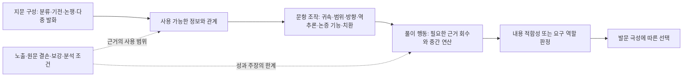

# 패턴 계층과 적용·비적용 조건

## 계층은 세 층의 관계망이다

지문 구성, 문항 조작, 풀이 행동은 서로 다른 단위다. 한 지문 조직이 여러 풀이를 허용하고 한 풀이가 서로 다른 지문 조직에서 쓰일 수 있다. 따라서 모든 후보를 한 줄짜리 분류 나무의 말단으로 만들지 않는다. 아래 가족 수는 설명 편의를 위한 구조이며 최종 패턴 수가 아니다.

T1(TXT-A)은 **분류→조건→작동 사례**, T2(TXT-B)는 **구조→기전→신호→판정→성능**, T3(TXT-C)는 **선행 주장→한계→변경/종합**, T4(TXT-D)는 **제안→반대→대안→회고**다. T4는 논쟁형 구성의 한 구현이지만 T3가 설명자의 재구성이라면 T4는 인용 목소리의 귀속을 직접 관리해야 한다. 단일 지문 근거의 T2·T4를 광범위한 평가원 문체 법칙으로 확정하지 않는다.

문항층은 M1 귀속·역할 변경, M2 새 사례 적용/역방향 질문, M3 지지·반론 역할 요구, M4 범위·강도 확대, M5 조건·비교·시점 변경, M6 문단 기능 재서술, M7 문맥 어휘 교체로 기술한다. M2 안에서도 순방향 적용과 역상 계산은 별개다. 기존 ASK-D처럼 ‘내용 재서술’만으로는 너무 넓으므로 실제 바뀐 필드를 기록한다.

## 풀이 연산 가족

|가족|기존 후보와 잠정 후보|공유하는 질문|합치지 않는 차이|
|---|---|---|---|
|귀속·지시·역할|P01, S06, N01, N10, N11|누가 무엇을 어느 관계에서 말하거나 가리키는가?|정해진 귀속 회수 / 새 사례 대응 / 새 심리 근거 / 지시 해소 / 집단 연속성|
|판단 축·범위|P02, S05, N09|같은 질문의 답을 비교하는가? 진술 강도가 허가되는가?|축 이동 / 규정-실행 / 가능-필요 / 부분-전체 / 약함-없음|
|비교의 허가와 연산|P03, N05, N08, R10 경계|무엇을 고정하고 어떤 관계로 대소를 전달하는가?|역순 / 연쇄 / 상대비 / 조건부 분모 / 문턱 / 제약 상호작용 / 부분 순서|
|경로·전제·역추론|P04, N03, N07, S01, S04|입력과 출력 사이에 무엇을 알 수 있는가?|필요 전제 / 결합 실패 / 닫힌 모형 역상 / 개인별 갱신 / 유보 원인|
|정당화·논증 역할|N02, N04, S02|왜 그 설명이 성립하며 이 진술이 어떤 근거가 되는가?|정의 의존 / 반박 대상 / 관측 판별 / 가상 반례 / 담화 기능|
|상태와 사건 배치|P07|그 시점에 무엇이 발생·제거·잔존했는가?|영상 처리 / 기전 선후 / 역사 시점; 정의 의존은 제외|
|문맥·글의 조직|P05, S03|해당 문맥 또는 문단 기능이 표현을 허용하는가?|어휘 치환 / 해석 후보 제한 / 전개 동작; 문학 시점은 잔여|
|목적과 수단|P06, N06|어느 문제를 어느 작용점에서 줄이는가?|권력 통제 / 통치 의존 교정 / 오류별 후속 경로 선택|

여러 가족에 걸친 사례는 중복 오류가 아니다. 다만 같은 사건을 다시 이름 붙여 독립 증거를 늘리면 안 된다. 예를 들어 RX의 실제/판정 분리→분모 선택→비율 방향은 연결된 서로 다른 단계다.

## N 후보의 최소 명세

N 식별자는 코드북 밖의 잔여를 소실 없이 보존하는 작업 C의 이름이다. 신규 확정 100코드도, 서로 배타적인 11개 패턴도 아니다. 일부는 기존 상위 가족의 새 하위형이며 일부는 독립 연산 후보다.

|ID·상태|입력과 중간 연산|결론·실제 근거|적용 조건|비적용·재분할 조건|
|---|---|---|---|---|
|N01 정의의 관계 보존 / 반복 후보|정의의 역할·대상 수·동시성·방식에 사례의 항을 대입|JO①의 관찰자 운동, JO④의 동시 집단 조건 결손; RY②의 방식별 구성|정의에 판별 조건이 있고 사례의 대응 항을 확인할 수 있음|소재 이름만 같거나 추가 실제 반응을 보장할 때 제외. JN④는 불필요 필요조건 부과라는 N09도 필요|
|N02 정의 정당화의 순환 / 단일 문항·노출 제한|각 설명이 의존하는 개념을 연결하고 시작 개념 재사용을 확인|NL④의 분석 명제→동의성→필연성→분석 명제|본문이 정당화 의존을 명시함|기전의 시간 순서·상호 관련성만으로 순환이라고 하지 않음. 외부 철학의 참거짓으로 일반화 금지|
|N03 결합 전제 실패의 비식별 / 단일 지문·노출 제한|예측에 사용한 H·B·C를 분해하고 실패와 양립하는 수정 경로를 남김|NM①·⑤: 실패 원인 H 단정 불가, 다른 조건 수정으로 유지 가능|결합 입력과 대안 수정 가능성이 제시됨|배경이 고정·입증되어 특정 가설만 시험된 경우 자동 유보 금지. 필요 전제 회수 P04와 분리|
|N04 내용과 논증 역할 / 상위 반복·하위 분리|목표 주장→실제 전제→후보의 내용→지지/반박/제안 기능을 연결|GK, NN, AYF, AYG, ATO|발문이 증거·비판·대안 등의 역할을 요구하거나 그 역할이 선택지를 가름|내용 일치만 묻는데 불필요한 논증 기능 요구 금지. 세 하위형의 교육 전이 미검증|
|N05 조건부 분모 / P03 잠정 하위형|실제 상태 집합을 고정하고 그 내부의 성공·오류 비율을 비교|RX의 민감도·특이도|조건 집합과 분모가 정의되고 건수 비교 시 분모가 고정됨|다른 집단의 절대 건수만으로 비율 비교 금지. 신호색 자체는 비율의 분모가 아님|
|N06 목적에서 오류 우선순위 / 잠정 확장|검사 후 경로를 그려 오류마다 놓치는 대상·추가 절차를 비교|RY④의 선별→확인|목적과 후속 절차가 주어짐; 본문 범위의 정성 판단|모든 검사에 민감도 우선 일반화 금지. 비용·유병률·임계값 없는 수치 최적화 금지|
|N07 전수 모형의 역상 / 단일 지문|가능 입력 전부와 출력을 확인한 뒤 관측 출력에 맞는 행을 모음|YT: 집단3/4 확정, 집단1/2 효능감 유보|모형 완결·보기 부합·빠진 원인 없음이 보장됨|일반 A→B를 역으로 뒤집기 금지. 입력이 하나 남지 않아도 공통 성분은 확정 가능|
|N08 단조성 허가 점검 / 이종 하위 반복|양의 순서에서 성과 순서로 갈 때 추가 관계가 있는지 확인|BJ⑤의 충분 문턱, AYE⑤·AYG④의 조건 수와 효율|선지가 증가·비례·항상 개선을 주장하고 원문 허용 관계를 검사할 수 있음|비단조 가능→항상 악화 금지. 문턱 이후와 제약 상호작용의 기전은 분리|
|N09 범위·강도 보존 / 상위 반복|주체·영역을 고정하고 가능/필요·일부/전체·약함/없음의 변경을 찾음|AA②, JN④, RV③·RW④, BK②, ATN③|원문 양태·범위 또는 반례 상태가 확인됨|강한 표현이라는 이유만으로 오답 처리 금지. 본문이 전체/필요를 허가하면 인정|
|N10 추가 성분의 근거 / 잠정 상위 가족|관찰된 행동과 선지가 더한 동기·감정·평가 성분을 나누고 각각 근거 확인|ATN③, AVT①, AQP①|추가한 성분과 원문 확인 범위를 특정할 수 있음|본문 부재→현실 부재로 확대 금지. 문학 관점 추정과 역사적 동기 판단의 동일성 유보|
|N11 표현의 지시 대상 / 단일 문항 중심|화자·시점·정책을 고정해 동일 어휘의 지시 연결을 복원|ATP의 ㉠=㉢=㉤, ㉡·㉣의 새 방안 문제|앞뒤 지칭·비교·회고의 연결 근거가 있음|같은 뜻→같은 대상, 다른 평가→다른 대상 금지. 집단 구성원 동일성 S06과 자동 통합 금지|

## 반드시 구분할 논리적 상태

1. **명시적 반박**: 단안으로 가능하다는 본문과 양안이 필수라는 선지가 충돌한다(JN④).
2. **근거 부족**: A/B 생산비 서열이 없다(AYF③). 반대 서열이 참으로 확정된 것은 아니다.
3. **요구 역할 불충족**: 내용이 이론과 양립해도 해당 반론이나 지지 사례는 아니다(NN①, AYF⑤).
4. **논리적 미확정**: 완결된 모형에서도 여러 입력이 같은 출력을 낳는다(YT).
5. **원문 결손**: 판단해야 할 B열을 읽을 수 없다(RX의 Sol 단계). 보강 전 비적용으로 코딩하지 않는다.
6. **연구상 반복 미검증**: 한 지문의 여러 문항에서 같은 조작이 보여도 독립 지문 반복은 아니다(N02·N03·N05·N07·N11).

‘부적절한 것’을 묻는 문항에서는 내용상 반박된 선지가 정답으로 선택된다. 긍정/부정 발문의 선택 행동은 위 상태와 별도 필드다. 교육 설명에서도 ‘틀렸으므로 제외’와 같이 발문을 생략하지 않는다.

## 규칙을 바꿀 증거

최소 조건을 만족하는 새 기출에서 결론이 실패하면 규칙 자체의 반례로 검토한다. 조건 하나가 빠져 실패하면 적용 범위 경계다. 같은 정답에 더 짧은 타당 경로가 있으면 유일·필수 절차 주장을 낮춘다. 동일 하위 연산이라던 두 장면에서 필요한 입력이나 실패 지점이 다르면 분할한다. 서로 다른 이름인데 입력·연산·제한이 같으면 통합 검토하되 원 ID와 최초 출처를 지우지 않는다. 학생 전이 실패는 교육 단원 설계의 증거이며 그 자체가 형식 논리 관계의 반례는 아니다.
