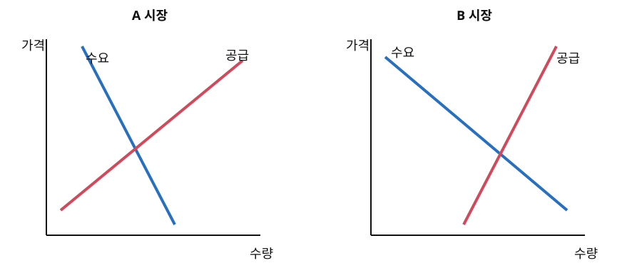

# 경제 02 — 시장 균형과 탄력성

## 1. 지문

시장경제에서는 수요와 공급의 상호 작용으로 가격과 거래량이 결정된다. 다른 조건이 같을 때 가격이 오르면 수요량은 감소하고 공급량은 증가한다. 이처럼 가격 변화에 따라 같은 수요 곡선이나 공급 곡선 위에서 수량이 변하는 것과, 가격 이외의 조건이 변하여 곡선 자체가 이동하는 것은 구별해야 한다. 소득이나 선호의 변화는 수요를, 생산 기술이나 생산 요소 가격의 변화는 공급을 이동시킬 수 있다.

한 재화의 가격 변화는 다른 재화의 수요에도 영향을 줄 수 있다. 한 재화의 가격이 오를 때 다른 재화의 수요가 증가하면 두 재화는 대체 관계에, 다른 재화의 수요도 감소하면 보완 관계에 있다고 할 수 있다. 따라서 어떤 재화의 수요가 증가했다는 사실만으로 그 재화 자체의 가격이 변했다고 단정할 수 없으며, 소득·선호·연관재 가격 가운데 무엇이 변했는지를 구별해야 한다.

수요량과 공급량이 일치하는 가격을 균형 가격이라 한다. 수요가 증가하고 공급이 변하지 않으면 균형 가격과 균형 거래량은 모두 증가한다. 공급이 증가하고 수요가 변하지 않으면 균형 가격은 하락하고 균형 거래량은 증가한다. 그러나 수요와 공급이 동시에 증가하면 거래량은 증가하더라도 가격의 방향은 두 변화의 상대적 크기에 따라 달라진다. 따라서 원인이 둘 이상인 경우 한 곡선의 이동 방향만으로 가격 변화를 확정할 수 없다.

가격 변화율의 절댓값에 대한 수량 변화율의 절댓값의 비율을 가격 탄력성이라 한다. 가격이 같은 비율로 변할 때 수량의 변화율이 클수록 가격에 더 탄력적으로 반응한다고 한다. 필수성이 크거나 대체재가 적은 재화는 수요량의 가격 반응이 작을 수 있고, 생산량을 조절하는 데 시간이 오래 걸리면 단기의 공급량은 가격에 작게 반응할 수 있다. 탄력성은 변화의 방향이 아니라 변화의 정도를 나타내므로, 수요량이 가격과 반대 방향으로 움직인다는 사실만으로 탄력성의 크기를 알 수는 없다.

정부가 거래 한 단위마다 일정액의 세금을 부과하면 구매자가 지불하는 가격과 판매자가 세금을 제외하고 받는 가격 사이에 세액만큼 차이가 생긴다. 세금을 법적으로 어느 쪽이 납부하는지는 행정상의 의무를 정하지만, 세금으로 인한 실질 부담이 누구에게 더 크게 나타나는지는 수요량과 공급량의 가격 반응에 따라 달라진다. 가격에 덜 반응하는 쪽은 거래를 줄여 세금을 피하기 어려우므로 더 큰 부담을 지는 경향이 있다. 이때 구매자가 부담하는 부분은 세전 균형 가격에 비해 구매 가격이 오른 폭으로, 판매자가 부담하는 부분은 판매자가 받는 가격이 낮아진 폭으로 나타난다. 두 폭의 합은 단위당 세액과 같다.

세금은 일반적으로 거래량을 감소시키므로 세수뿐 아니라 거래 감소에 따른 잉여의 손실도 발생시킬 수 있다. 탄력적인 쪽일수록 가격 변화에 수량을 크게 조절하므로, 다른 조건이 같다면 수요와 공급이 모두 탄력적인 시장에서 같은 세금이 초래하는 거래량 감소가 더 클 수 있다. 따라서 세 부담의 분배와 거래량 감소를 같은 문제로 보아서는 안 된다.

## 2. 문항

### 1. 윗글의 내용과 일치하지 않는 것은?

① 재화의 가격 변화로 수요량이 변하는 것은 같은 수요 곡선 위의 이동으로 나타낼 수 있다.

② 수요와 공급이 동시에 증가하면 균형 거래량의 방향은 알 수 있지만 균형 가격의 방향은 확정되지 않을 수 있다.

③ 생산량 조정에 시간이 오래 걸리는 재화는 단기 공급량의 가격 반응이 작을 수 있다.

④ 수요량이 가격과 반대 방향으로 움직인다는 사실이 확인되면 수요 탄력성의 크기도 결정된다.

⑤ 세금의 법적 납부자와 세금의 실질 부담이 더 크게 나타나는 경제 주체는 다를 수 있다.

### 2. 윗글을 바탕으로 추론한 내용으로 가장 적절한 것은?

① X재의 가격이 상승하여 X재의 수요량이 감소했다면, 가격 이외의 조건이 변하지 않았더라도 X재의 수요 곡선은 왼쪽으로 이동한다.

② X재와 Y재가 보완 관계일 때 X재의 가격이 상승하면 Y재의 수요가 증가하므로, Y재의 공급이 일정하다면 Y재의 균형 가격도 상승한다.

③ X재의 가격 상승으로 Y재의 수요가 증가했다면 두 재화는 대체 관계이며, Y재의 공급이 일정할 때 Y재의 균형 가격과 거래량은 모두 증가할 수 있다.

④ 수요 증가와 공급 감소가 동시에 나타나면 두 변화가 거래량에 미치는 방향은 같으므로 균형 거래량은 반드시 증가한다.

⑤ 수요가 공급보다 가격에 덜 반응하는 시장에서는 판매자가 세금을 납부하도록 정한 경우에만 구매자의 실질 부담이 판매자보다 커진다.

### 3. 윗글을 바탕으로 `<보기>`를 이해한 내용으로 적절하지 않은 것은?

> **보기**  
> X재 시장에서 소비자의 소득 증가로 수요가 증가하는 동시에 생산 기술의 향상으로 공급도 증가하였다. 그 결과 균형 가격은 변하지 않고 균형 거래량은 증가하였다. 이후 거래 한 단위당 12의 세금이 부과되자 구매 가격은 종전 균형 가격보다 8 높아졌고, 판매자가 세금을 제외하고 받는 가격은 종전보다 4 낮아졌다.

① 소득 증가와 기술 향상은 각각 가격 이외의 조건을 변화시켜 곡선을 이동시켰겠군.

② 세금이 판매자에게 법적으로 부과되었다면 판매자가 단위당 세금 12를 모두 실질적으로 부담했겠군.

③ 세금 부과 전 가격이 변하지 않았다는 사실만으로 수요와 공급의 이동 폭이 각각 얼마였는지는 알 수 없겠군.

④ 세금 부과 뒤 구매자가 부담한 단위당 금액은 판매자가 부담한 단위당 금액의 두 배이겠군.

⑤ 수요 증가가 가격에 미치는 영향과 공급 증가가 가격에 미치는 영향이 서로 반대였겠군.

### 4. 윗글과 `<보기>`를 바탕으로 A, B 시장을 이해한 내용으로 가장 적절한 것은?

> **보기**  
> 아래 그림은 동일한 축척으로 그린 두 시장의 수요량과 공급량의 가격 반응을 나타낸다. 각 시장에서 수요 곡선과 공급 곡선은 같은 점에서 만나며, 두 시장에 같은 단위당 세금을 부과한다. 세금 부과 전후의 작은 가격 범위에서는 그림에 제시된 상대적 반응 정도가 유지되고 다른 조건은 변하지 않는다.
>
> 

① A에서는 수요량이 공급량보다 가격에 더 크게 반응하므로, 판매자가 받는 가격의 하락 폭이 구매 가격의 상승 폭보다 크겠군.

② A에서는 B보다 수요량의 가격 반응이 작으므로, 같은 세금에 따른 구매 가격의 상승 폭도 B보다 작겠군.

③ B에서는 공급량이 수요량보다 가격에 덜 반응하므로, 판매자가 받는 가격의 하락 폭이 구매 가격의 상승 폭보다 크겠군.

④ B에서는 공급량이 가격에 작게 반응하므로 세금 부과 뒤 판매자가 받는 가격은 낮아지지만 거래량은 세전 수준에서 변하지 않겠군.

⑤ A와 B에서 세금의 법적 납부자를 모두 판매자로 정하면, 수요량과 공급량의 상대적 가격 반응이 달라도 두 시장의 실질 부담 분배는 같겠군.

## 3. 정답과 근거

- 1번 ④
  - 수요 법칙은 변화 방향을, 탄력성은 변화 정도를 나타낸다.
- 2번 ③
  - X재 가격 상승으로 Y재 수요가 증가하므로 두 재화는 대체 관계이다. Y재의 공급이 일정하면 수요 증가는 Y재의 균형 가격과 거래량을 모두 높일 수 있다.
- 3번 ②
  - 법적 납부 주체와 실질 부담은 구별된다. 실제 부담은 구매자 8, 판매자 4이다.
- 4번 ③
  - B에서는 공급량이 수요량보다 가격에 덜 반응하므로 판매자가 더 큰 부담을 지는 경향이 있다. A에서는 수요량의 반응이 더 작으므로 구매자 부담이 더 크다.

## 4. 설계·난도 기록

- 통합사회 개념: 시장경제, 수요·공급, 시장 가격
- 심화 개념: 곡선 이동, 동시 변동, 가격 탄력성, 조세 부담
- 핵심 구조: 방향/정도, 곡선상 이동/곡선 이동, 법적 납부/실질 부담
- 문항 역할·난도: 1번 개념 범위형(중상), 2번 연관재·균형 통합형(상), 3번 조건 적용형(상), 4번 그래프 전환형(최상)
- 경쟁 경로: 수요·공급의 동시 이동이 가격과 거래량에 주는 효과, 법적 납부와 실질 부담, 부담 분배와 거래량 감소
- 시각 자료 의존성: 4번의 A·B별 상대적 가격 반응은 SVG의 곡선 기울기에서만 확정됨.
- 품질 평가: **89/100** — 탄력성을 변화율의 절댓값 비율로 고치고 곡선 이동·연관재·조세 부담의 문항 역할을 분리함.
- 난도 평가: **85/100** — 연관재의 수요 이동과 균형 변화, 상대적 탄력성과 조세 부담을 연쇄적으로 판단해야 함.
- 품질 필수 조건(정보 충족도): **충족** — 세 부담 판정 기준과 세액의 분해 관계를 본문에 제시함.
- 최고난도 문항: 4번 — 시각 자료에서 상대적 가격 반응을 읽고 세 부담의 방향으로 전환해야 함.
