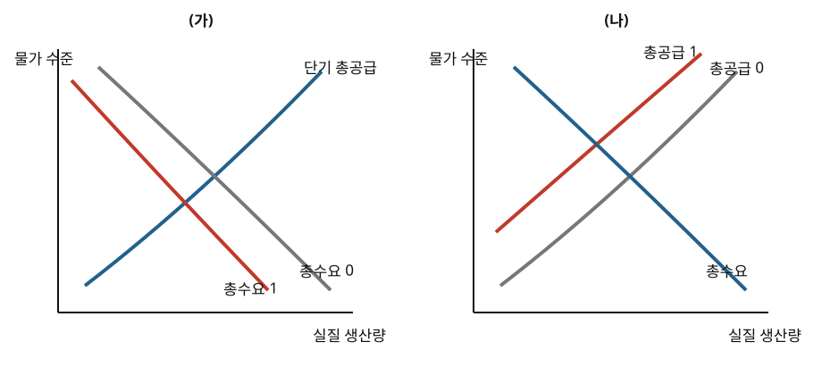

# 경제 07 — 경기 변동과 정책 조합

## 1. 지문

경제 활동이 확장과 위축을 반복하는 현상을 경기 변동이라 한다. 국민 경제 전체의 생산과 물가는 총수요와 총공급의 관계로 설명할 수 있다. 총수요는 가계의 소비, 기업의 투자, 정부 지출, 순수출 등 경제 전체의 지출을 물가 수준별로 나타낸 것이고, 단기 총공급은 기업들이 물가 수준별로 생산하려는 양을 나타낸 것이다. 총수요와 단기 총공급이 만나는 점에서 단기의 물가 수준과 실질 생산량이 결정된다.

소비·투자·정부 지출·순수출 가운데 하나가 감소하면 총수요가 줄어 물가 수준과 실질 생산량이 함께 낮아질 수 있다. 반면 원자재 가격이나 임금 같은 생산 비용이 상승하면 단기 총공급이 줄어 물가 수준은 높아지고 실질 생산량은 감소할 수 있다. 두 경우 모두 생산량이 감소하지만 물가의 방향은 반대이므로, 생산량 감소만 보고 충격의 원인을 확정할 수 없다.

정부가 지출을 늘리거나 조세를 줄여 총수요를 확대하는 것을 확대 재정 정책이라 한다. 경기 침체가 총수요 감소에서 비롯되었다면 이 정책은 생산량을 회복시키는 데 이용될 수 있다. 그러나 정부가 지출 재원을 마련하기 위해 채권을 발행하면 자금 수요가 늘어 시장 금리가 상승할 수 있다. 금리 상승으로 민간 투자가 감소하면 정부 지출 증가분의 일부가 상쇄되는데, 이를 구축 효과라 한다. 따라서 정부 지출 증가액과 총수요의 최종 증가액이 언제나 같지는 않다.

재정 제도 중에는 별도의 정책 결정을 기다리지 않고 경기 변동을 완화하는 것도 있다. 누진적인 소득세와 실업 급여가 그 예이다. 경기가 위축되면 소득과 세금 부담은 감소하고 실업 급여 지급은 늘어 민간의 처분 가능 소득 감소를 완화할 수 있다. 반대로 경기가 과열되면 세금 부담이 늘어 총수요의 증가를 억제할 수 있다. 이러한 장치는 정책 결정의 시차는 줄이지만 경기 변동을 완전히 제거하지는 못한다.

반면 새로운 사업을 정하고 예산을 편성하는 재량적 재정 정책은 결정과 집행에 시간이 걸릴 수 있어 충격의 시점과 정책 효과가 나타나는 시점이 달라질 수 있다.

중앙은행은 통화량이나 금리를 조절하는 통화 정책을 사용할 수 있다. 중앙은행이 금융 기관으로부터 채권을 매입하면 금융 시장에 자금이 공급되어 시장 금리가 하락할 수 있다. 금리 하락이 소비와 투자를 늘리면 총수요가 증가한다. 반대로 채권 매도는 자금을 흡수하여 금리를 높이고 총수요를 줄이는 방향으로 작용할 수 있다. 정책이 실제 소비·투자와 생산에 영향을 미치기까지 시간이 걸리고 경제 주체의 반응 정도도 달라질 수 있으므로, 정책 수단의 최초 변화만으로 최종 효과의 크기를 확정할 수는 없다.

총공급 감소로 생산량이 줄고 물가가 오른 상황에서는 총수요 확대 정책의 판단이 더 복잡하다. 총수요를 늘리면 생산량 감소를 완화할 수 있지만 물가 상승을 더 크게 만들 수 있다. 반대로 물가를 낮추기 위해 총수요를 줄이면 생산량이 더 감소할 수 있다. 또한 확대 재정 정책과 긴축 통화 정책을 동시에 시행하면 전자는 총수요를 늘리고 후자는 줄이므로 생산량과 물가의 최종 방향은 두 정책의 상대적 크기에 따라 달라질 수 있다.

## 2. 문항

### 1. 윗글의 내용과 일치하지 않는 것은?

① 중앙은행의 채권 매입은 금융 시장의 자금을 흡수하여 시장 금리를 높이는 방향으로 작용한다.

② 생산 비용 상승은 물가 수준 상승과 실질 생산량 감소를 동시에 일으킬 수 있다.

③ 정부의 채권 발행으로 시장 금리가 상승하면 민간 투자가 감소할 수 있다.

④ 총수요 감소는 물가 수준과 실질 생산량을 함께 낮출 수 있다.

⑤ 재정 정책과 통화 정책이 총수요에 반대 방향으로 작용하면 최종 효과는 상대적 크기에 따라 달라질 수 있다.

### 2. 윗글을 바탕으로 추론한 내용으로 가장 적절한 것은?

① 경기가 위축되어 가계 소득과 세금 부담이 함께 감소하면 세금 부담 감소가 처분 가능 소득을 더 줄이므로 총수요 감소 폭은 확대될 수 있다.

② 경기가 위축될 때 기존 제도에 따라 소득세 부담이 감소하고 실업 급여 지급이 증가하면, 새로운 정책을 결정하지 않아도 민간의 처분 가능 소득 감소가 완화될 수 있다.

③ 자동 안정화 장치는 별도의 정책 결정을 기다리지 않고 작용하므로 경기 변동을 완전히 제거할 수 있다.

④ 총공급 감소로 생산량과 물가가 반대 방향으로 변한 상황에서 총수요를 확대하면 생산량 감소와 물가 상승을 동시에 완전히 해소할 수 있다.

⑤ 확대 재정 정책과 긴축 통화 정책은 총수요에 반대 방향으로 작용하므로 두 정책의 상대적 크기를 알지 못하더라도 총수요가 변하지 않는다고 판단할 수 있다.

### 3. 윗글을 바탕으로 `<보기>`를 이해한 내용으로 적절하지 않은 것은?

> **보기**  
> 경기 침체에 대응하여 A국 정부는 같은 규모의 지출 확대를 두 번 실시하였다. 1기에는 중앙은행이 통화량을 그대로 유지하여 정부의 채권 발행 뒤 시장 금리가 상승하였다. 2기에는 중앙은행이 채권을 매입하여 시장 금리가 상승하지 않게 하였다. 다른 조건은 같고 금리가 높을수록 민간 투자는 감소한다.

① 1기에는 정부 지출 증가의 일부가 민간 투자 감소로 상쇄될 수 있겠군.

② 2기의 중앙은행 채권 매입은 금융 시장의 자금 공급을 늘리는 방향으로 작용했겠군.

③ 정부 지출 규모가 같더라도 1기와 2기의 총수요 증가 폭은 다를 수 있겠군.

④ 다른 조건이 같다면 2기보다 1기에서 구축 효과가 더 크게 나타날 수 있겠군.

⑤ 2기에 시장 금리가 상승하지 않았으므로 정부 지출은 총수요를 감소시켰겠군.

### 4. 윗글과 `<보기>`를 바탕으로 그래프를 이해한 내용으로 가장 적절한 것은?

> **보기**  
> 아래 그래프에서 0은 충격 전, 1은 충격 후를 나타낸다. 다른 조건은 변하지 않는다.
>
> 

① (가)에서는 물가가 상승하고 실질 생산량이 감소하겠군.

② (나)에서는 물가와 실질 생산량이 모두 감소하겠군.

③ (가)의 생산량 감소를 완화하기 위한 총수요 확대는 최초 충격과 같은 방향의 곡선 이동이겠군.

④ (나)에서 총수요를 확대하면 생산량 감소를 완화할 수 있지만 물가 상승 폭은 더 커질 수 있겠군.

⑤ (가)와 (나)는 생산량과 물가가 모두 같은 방향으로 변하므로 충격의 원인을 구별할 수 없겠군.

## 3. 정답과 근거

- 1번 ①
  - 중앙은행의 채권 매입은 금융 시장에 자금을 공급하여 금리를 낮추는 방향으로 작용한다.
- 2번 ②
  - 누진적 소득세와 실업 급여는 별도의 정책 결정을 기다리지 않고 처분 가능 소득의 감소를 완화하는 자동 안정화 장치로 기능할 수 있다.
- 3번 ⑤
  - 2기에는 금리 상승과 투자 감소가 억제되므로 같은 정부 지출이 총수요를 더 크게 늘릴 수 있다.
- 4번 ④
  - (나)는 총공급 감소이므로 물가는 상승하고 생산량은 감소한다. 총수요 확대는 생산량을 늘리는 대신 물가를 더 높일 수 있다.

## 4. 설계·난도 기록

- 통합사회 개념: 경기 변동, 정부와 중앙은행의 역할
- 심화 개념: 총수요·총공급, 구축 효과, 재정·통화 정책 조합
- 핵심 구조: 총수요 충격/총공급 충격, 최초 정책/최종 효과, 재정 확대/통화 긴축
- 문항 역할·난도: 1번 정책 방향형(중상), 2번 자동 안정화 추론형(상), 3번 정책 조합 적용형(상), 4번 그래프·경쟁 경로형(최상)
- 경쟁 경로: 총수요/총공급 충격, 정부 지출 증가/구축 효과, 생산량 회복/물가 상승, 재정 확대/통화 긴축
- 시각 자료 의존성: 4번의 (가)·(나)별 이동 곡선과 이동 방향은 SVG에서 판별해야 함.
- 품질 평가: **92/100** — 자동 안정화 오답의 독립 오류를 하나로 줄이고 정책 수단별 판단 기능을 분리함.
- 난도 평가: **89/100** — 같은 생산 감소를 물가 방향으로 구별하고 정책의 최초 작용과 최종 효과를 추적해야 함.
- 품질 필수 조건(정보 충족도): **충족** — 충격별 물가·생산 방향과 정책 전달 경로를 본문에 제공함.
- 최고난도 문항: 4번 — 같은 생산 감소를 낳는 두 충격을 물가 방향으로 구별하고 정책의 상반 효과를 판단해야 함.
